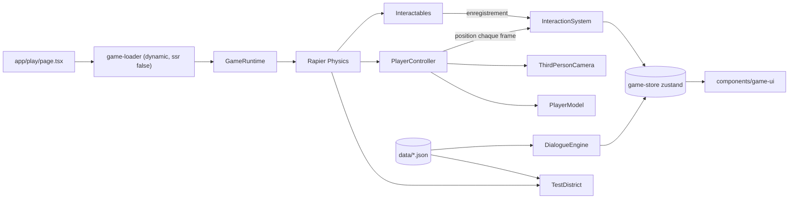

# Architecture technique

Version couvrant les Phases 0 et 1 (prototype). Référence produit : [MASTER_DOCUMENT.md](MASTER_DOCUMENT.md).

## Stack

| Couche | Choix | Version |
| --- | --- | --- |
| Application | Next.js (App Router, Turbopack) + TypeScript strict | 16.4 |
| UI | React + Tailwind CSS | 19.3 / 4 |
| Rendu 3D | three.js via React Three Fiber + drei | 0.186 / 9.8 / 10.7 |
| Physique | Rapier 3D via `@react-three/rapier` (WASM) | 2.2 |
| État partagé | zustand | 5 |
| Validation des données | zod | 4 |
| Tests | Vitest (logique pure), Playwright (smoke tests) | 5 / 1.64 |

## Principes

- Le runtime 3D est un Client Component chargé avec `next/dynamic` et `ssr: false` (WebGL et WASM n'existent pas côté serveur).
- La logique de jeu (entrées, états d'animation, interaction, dialogue) est écrite en fonctions pures dans `game/**/*.ts` et testée par Vitest. Les composants `.tsx` se contentent de relier cette logique à R3F et au DOM.
- Les données de contenu (lieux, dialogues) vivent dans `data/` en JSON et sont validées par des schémas zod au chargement.
- La boucle de rendu (`useFrame`) ne passe jamais par l'état React : les valeurs à haute fréquence (entrées, position) sont lues dans des refs ou via `store.getState()`. Le store zustand ne reçoit que des changements discrets (PNJ à portée, dialogue ouvert, souris capturée).

## Flux

## Modules

| Module | Fichier | Rôle |
| --- | --- | --- |
| GameRuntime | `game/core/game-runtime.tsx` | Canvas, physique, éclairage, scène, HUD |
| Config | `game/core/config.ts` | Vitesses, rayons, clips d'animation |
| InputManager | `game/core/input-manager.ts` | Mapping clavier ZQSD/WASD/flèches → `InputState` |
| GameStore | `game/core/game-store.ts` | État discret partagé avec l'UI |
| WorldManager (provisoire) | `game/world/test-district.tsx` | Sol et bâtiments de test depuis `data/locations` |
| PlayerController | `game/player/player-controller.tsx` | Corps kinématique + `KinematicCharacterController` Rapier |
| Animation | `game/player/animation-state.ts`, `player-model.tsx` | Sélection idle/walk/run, cross-fade |
| CameraController | `game/camera/third-person-camera.tsx` | Orbite souris (pointer lock), zoom molette, suivi amorti |
| InteractionSystem | `game/interactions/interaction-system.ts` | Registre et sélection de l'interactable le plus proche |
| DialogueSystem | `game/dialogue/*` | Schéma, moteur pur, chargement des dialogues |

## Personnage et collisions

- Corps `kinematicPosition` + `CapsuleCollider` ; le déplacement passe par `world.createCharacterController()` (`computeColliderMovement`), qui gère les murs, les pentes et les marches (autostep).
- Gravité appliquée manuellement à la vitesse verticale, remise à zéro au sol (`computedGrounded`).
- La direction de marche est relative au yaw de la caméra ; l'orientation du modèle est lissée vers la direction de déplacement.

## Limites connues

- La caméra peut traverser les murs (pas encore de raycast caméra).
- Les bâtiments sont des volumes simples, pas des assets de Cotonou.
- Pas de contrôles tactiles.
